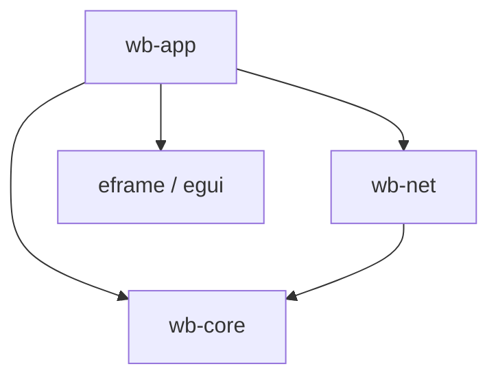
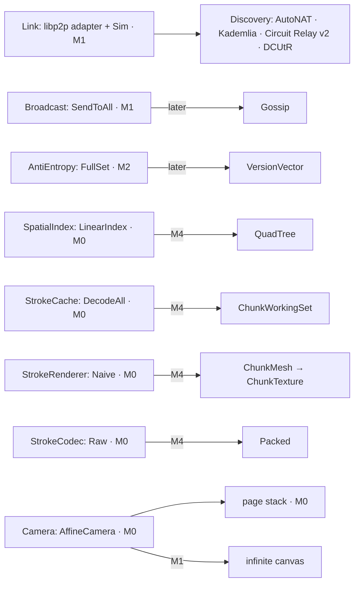
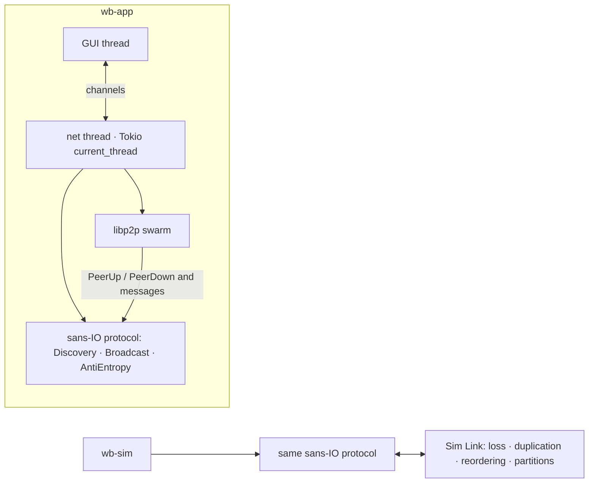

# Architecture

Crates, seams, and runtime structure. Intent → `docs/README.md` · decisions → `docs/adr/` · words →
`GLOSSARY.md` · contracts → `docs/contracts/` · complex flows → `docs/design/`.

## Crates and dependencies

`wb-core` knows no IO, GUI, or sockets. `wb-net` owns the sans-IO protocol and its libp2p adapter.

## Network seams

`Link` sends protocol messages up to 1200 B. Its stream uses a u16 big-endian length prefix outside
the cap; the envelope is the capped unit. Oversize length resets that stream; a malformed envelope
within the cap is counted and dropped while the stream stays open. `PeerId(u64)` is the first eight
bytes, big-endian, of SHA-256(libp2p `PeerId` bytes) for this run.

Connect order: direct dial; if AutoNAT says private, reserve Circuit Relay v2; attempt DCUtR; remain
on relay if that attempt fails. Homelab bootstrap/relay addresses live only in a user TOML config file in the user config
directory (for example, `bootstrap = ["<multiaddr>"]`); they are never committed to the repo. The
devnet supplies its own config file. With no user config file, Amino bootstrap and manual join
remain available, but relay does not. Manual join accepts `join <code> [ip:port | multiaddr]`; `ip:port` maps to
`/ip4/<ip>/udp/<port>/quic-v1`.

## Runtime and simulation

GUI and net thread use bounded `tokio::sync::mpsc` channels in both directions. The UI uses
`try_send` and never blocks; on a full channel it drops and logs, and calls `try_recv` each frame.
Net events wake the UI with egui `request_repaint`. Tokio owns the swarm and drives timers,
`AntiEntropy` cadence, and `RejectLog::tick`. It supplies
`now` to the core; the core never awaits. The GUI remains on its own thread. Simulation exercises
the same protocol deterministically; the real adapter is integrated in the ADR 0017 devnet for
direct, DCUtR, and relay paths.

## Crates

| Crate | Contents | Depends on |
|---|---|---|
| `wb-core` | geometry, board state, ops, pages, codec and spatial index seams | serde, postcard, thiserror, xxhash-rust |
| `wb-net` | sans-IO protocol, `Link` and libp2p adapter, discovery, broadcast, anti-entropy, deterministic `Sim`, `wb-sim` | core, libp2p |
| `wb-app` | GUI, tools, threads, save/load, join flow, rendering, PDF export | core, net, eframe/egui |

Local performance seams and their oracle/fast implementations remain listed in `docs/contracts/`.
Rule: `wb-core` knows nothing about IO, egui or sockets; sockets and threads live only in `wb-net` drivers and `wb-app`.

## Seams

| Seam | Layer 0 (simple) | Later layer (fast) |
|---|---|---|
| `SpatialIndex` | `Vec` + linear scan | quadtree |
| `StrokeRenderer` | egui painter, every visible stroke, every frame | cached chunk meshes → chunk textures (wgpu) |
| `StrokeCache` | `DecodeAll`: unpack once on arrival, keep all | `ChunkWorkingSet`: resident chunks + margin, byte budget |
| `Camera` | `AffineCamera`: affine matrix (pan + zoom) from day 1 | page stack (`PageStackController`, M0); infinite canvas (M1, ADR 0029) |
| `StrokeCodec` | origin + plain `i32` offsets via postcard | point reduction → delta → bit packing |
| `Link` | libp2p adapter · `Sim` (seeded loss/duplication/reordering/partitions) | — |
| `Discovery` | AutoNAT, Kademlia rendezvous, Circuit Relay v2, DCUtR; manual join | LAN / virtual network (M4) |
| `Broadcast` | send to every known peer | gossip (fanout k) |
| `AntiEntropy` | exchange full id sets | compact digests (version vectors / hashes) |

## Runtime (ADR 0004)

The protocol is a pure state machine: `handle(event, now) → Vec<Outgoing>`. The net thread and the
deterministic sim module are two drivers of the same code.

## Data flow: drawing a stroke

1. Pointer down/move → points collected in screen space → camera inverse → `i64` world space.
2. Pointer up → codec simplifies and encodes into one or more pieces (ADR 0005, 0014; stays
   encoded in memory). For each piece: compute its bounding box → `Board::stamp` reserves the `OpId`
   (ADR 0009) and Lamport timestamp (ADR 0008) → `Op::add` → `Board::apply` → insert into the
   spatial index → broadcast.
3. Anti-entropy heals anything broadcast lost (ADR 0003).
4. Remote op → net → main → `Board::apply` → index + invalidate the affected area.
5. Drawing and erasing read unpacked points only through `StrokeCache` (ADR 0018).

The same flow as a sequence diagram → `docs/design/stroke-lifecycle.md`.
