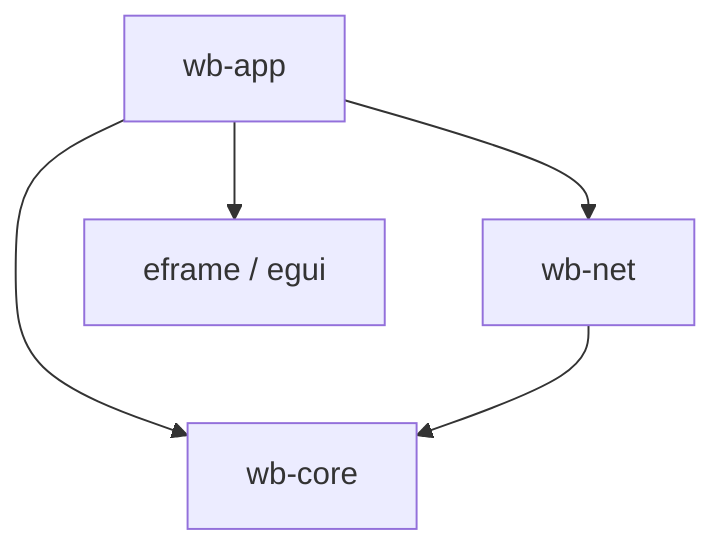
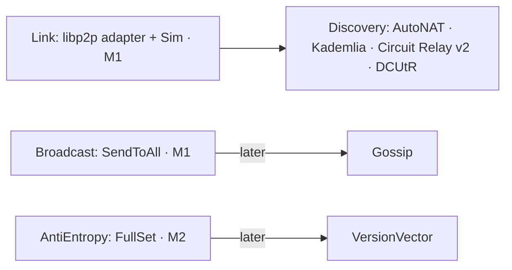
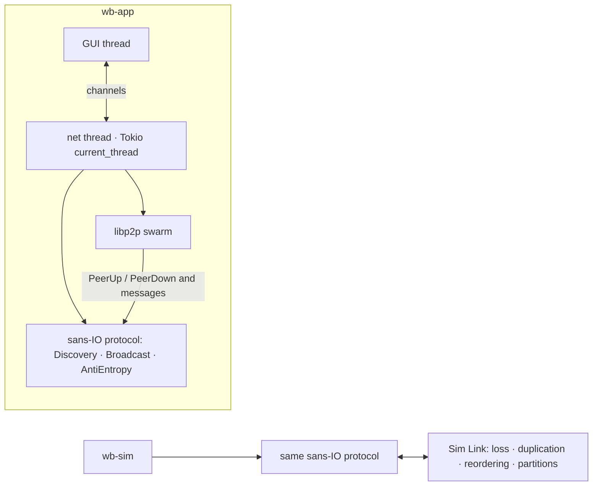

# Architecture

Crates, seams, and runtime structure. Intent → `docs/README.md` · decisions → `docs/adr/` · words →
`GLOSSARY.md` · contracts → `docs/contracts/` · complex flows → `docs/design/`.

## Crates and dependencies

`wb-core` knows no IO, GUI, or sockets. `wb-net` owns the sans-IO protocol and its libp2p adapter.

## Network seams

`Link` sends protocol messages up to 1200 B. Its stream uses a u16 big-endian length prefix outside
the cap; the envelope is the capped unit. Oversize length resets that stream; a malformed envelope
within the cap is counted and dropped while the stream stays open. `PeerId(u64)` is the first eight
bytes, big-endian, of SHA-256(libp2p `PeerId` bytes) for this run.

Connect order: direct dial; if AutoNAT says private, reserve Circuit Relay v2; attempt DCUtR; remain
on relay if that attempt fails. Homelab bootstrap/relay addresses live only in a user TOML config file in the user config
directory (for example, `bootstrap = ["<multiaddr>"]`); they are never committed to the repo. The
devnet supplies its own config file. With no user config file, Amino bootstrap and manual join
remain available, but relay does not. Manual join accepts `join <code> [ip:port | multiaddr]`; `ip:port` maps to
`/ip4/<ip>/udp/<port>/quic-v1`.

## Runtime and simulation

GUI and net thread use bounded `tokio::sync::mpsc` channels in both directions. The UI uses
`try_send` and never blocks; on a full channel it drops and logs, and calls `try_recv` each frame.
Net events wake the UI with egui `request_repaint`. Tokio owns the swarm and drives timers,
`AntiEntropy` cadence, and `RejectLog::tick`. It supplies
`now` to the core; the core never awaits. The GUI remains on its own thread. Simulation exercises
the same protocol deterministically; the real adapter is integrated in the ADR 0017 devnet for
direct, DCUtR, and relay paths.

## Crates

| Crate | Contents | Depends on |
|---|---|---|
| `wb-core` | geometry, board state, ops, pages, codec and spatial index seams | serde, postcard, thiserror, xxhash-rust |
| `wb-net` | sans-IO protocol, `Link` and libp2p adapter, discovery, broadcast, anti-entropy, deterministic `Sim`, `wb-sim` | core, libp2p |
| `wb-app` | GUI, tools, threads, save/load, join flow, rendering, PDF export | core, net, eframe/egui |

Local performance seams and their oracle/fast implementations remain listed in `docs/contracts/`.
