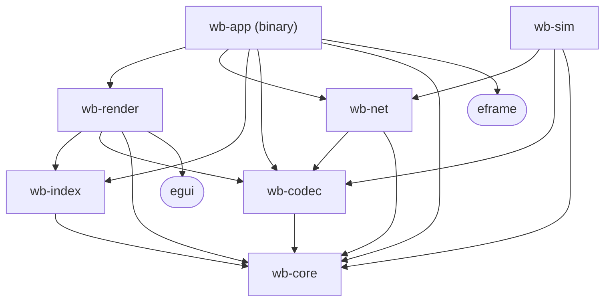
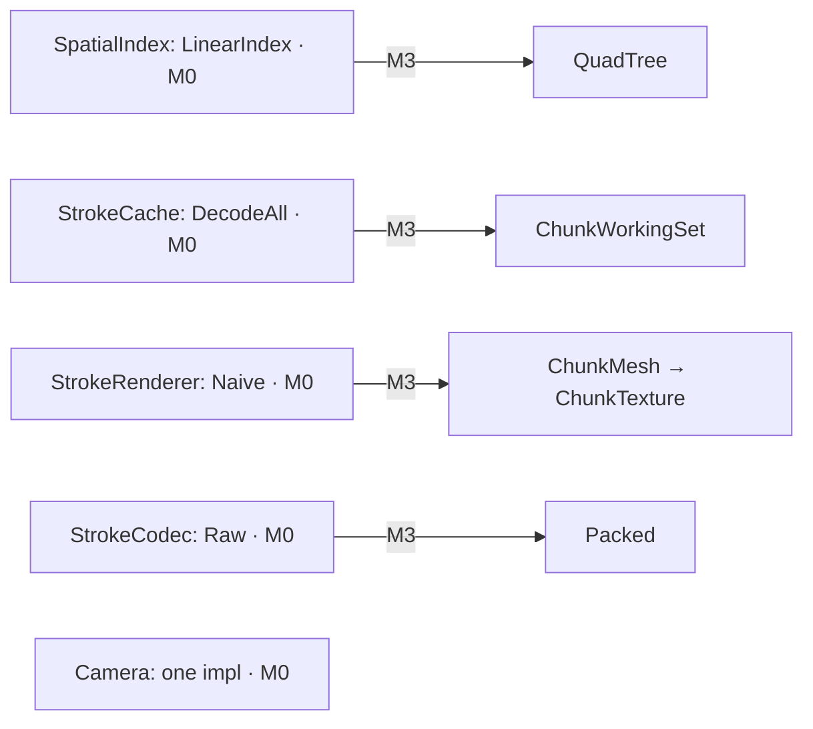
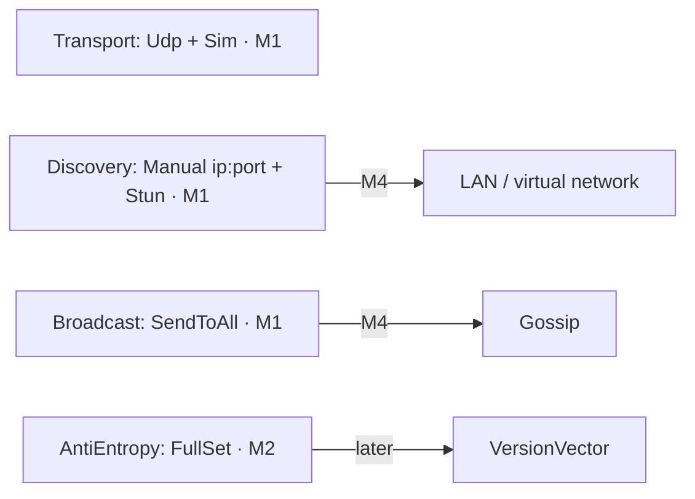
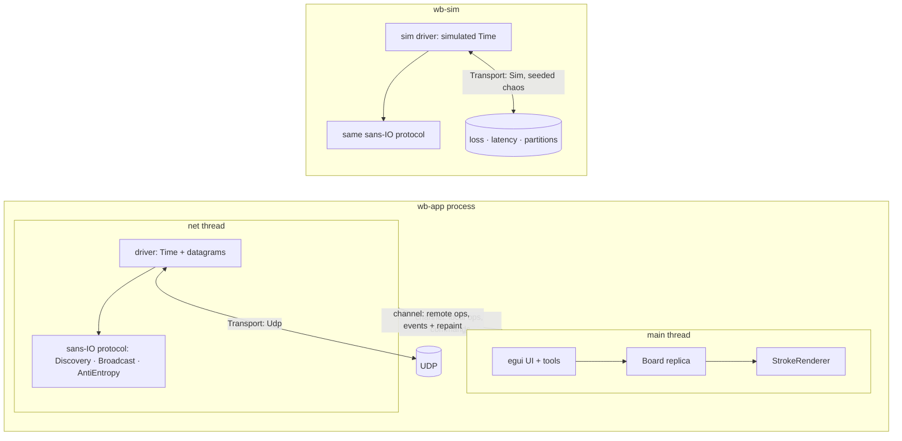

# Architecture

The structure we build once and keep: crates, seams, and what each seam starts as and grows into.
Intent → `docs/README.md` · decisions → `docs/adr/` · words → `GLOSSARY.md` ·
what each seam must do → `docs/contracts/` · diagrams of complex topics → `docs/design/`.

## Overview in diagrams

Crates and who may depend on whom (arrow = "depends on"; `wb-core` knows no IO, egui or sockets):

Seams on the local side — layer 0 is the oracle, the arrow is the later fast impl (milestone):

Seams on the network side:

Runtime (ADR 0004): two threads in the app; the simulator drives the same sans-IO protocol code:

Channel details (bounded or not, crate) are open in G21.

## Layering rule

Every performance idea lives behind a **seam** (a trait). Layer 0 is the simplest correct impl and
stays forever as the **oracle**: the fast impl must pass the same test suite and agree with the
oracle on random inputs, and must show a benchmark win, before it replaces layer 0 as the default.

## Crates (Cargo workspace, `crates/<name>`)

| Crate | Contents | Depends on |
|---|---|---|
| `wb-core` | geometry, `Stroke`, `StrokeId`, `Board` CRDT state + `merge`, ops, pages model | serde only |
| `wb-codec` | `StrokeCodec` seam, postcard wire/file format, version byte | core |
| `wb-index` | `SpatialIndex` seam | core |
| `wb-net` | sans-IO protocol state machine, `Transport` seam, discovery/rendezvous, manual join, `Broadcast`, anti-entropy | core, codec |
| `wb-render` | `Camera` (affine matrix), `StrokeRenderer` + `StrokeCache` seams, chunks, PDF export | core, codec, index, egui |
| `wb-app` | the binary: eframe window, tools, GUI menu + connect modal, threads, save/load, join flow | all except sim |
| `wb-sim` | in-process deterministic sim, headless bot peers, chaos, workload generators | core, codec, net |

Rule: `core` knows nothing about IO, egui or sockets. Only `app` and `sim` own threads and sockets.

## Seams

| Seam | Layer 0 (simple) | Later layer (fast) |
|---|---|---|
| `SpatialIndex` | `Vec` + linear scan | quadtree |
| `StrokeRenderer` | egui painter, every visible stroke, every frame | cached chunk meshes → chunk textures (wgpu) |
| `StrokeCache` | `DecodeAll`: unpack once on arrival, keep all | `ChunkWorkingSet`: resident chunks + margin, byte budget |
| `Camera` | affine matrix (pan + zoom) from day 1 | — (already cheap) |
| `StrokeCodec` | origin + plain `i32` offsets via postcard | point reduction → delta → bit packing |
| `Transport` | real UDP socket · `SimTransport` (seeded loss/latency/partition) | — |
| `Discovery` | localhost: probe a fixed port range on 127.0.0.1 | discovery protocol on the virtual network |
| `Broadcast` | send to every known peer | gossip (fanout k) |
| `AntiEntropy` | exchange full id sets | compact digests (version vectors / hashes) |

## Runtime (ADR 0004)

| Thread | Does |
|---|---|
| main | egui UI, tools, camera, render; owns the `Board` replica for drawing |
| net | blocking UDP socket + timers; drives the sans-IO protocol; talks to main via channels |

The protocol is a pure state machine: `handle(event, now) → Vec<Outgoing>`. The net thread and
`wb-sim` are just two drivers of the same code.

## Data flow: drawing a stroke

1. Pointer down/move → points collected in screen space → camera inverse → `i64` world space.
2. Pointer up → codec simplifies and encodes into one or more pieces (ADR 0005, 0014; stays
   encoded in memory). For each piece: compute its bounding box → `Board::draw` assigns the `OpId`
   (ADR 0009) and Lamport timestamp (ADR 0008) → insert into the spatial index → broadcast.
3. Anti-entropy heals anything broadcast lost (ADR 0003).
4. Remote op → net → main → `Board::apply` → index + renderer invalidate affected chunks.
5. Drawing and erasing read unpacked points only through `StrokeCache` (ADR 0018).

The same flow as a sequence diagram → `docs/design/stroke-lifecycle.md`.
