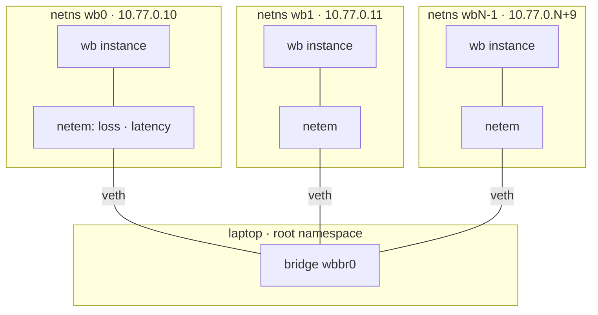
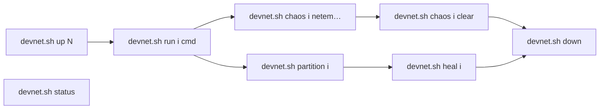

# Design: dev network on one laptop

Topology and lifecycle of the namespace dev network (ADR 0017). Script: T24 on the board.
Overview → `docs/architecture.md` · discovery contract → `docs/contracts/discovery.md`.

Namespaces are `wb0` through `wb<N-1>`, attached to bridge `wbbr0`. Namespace `wb<i>` uses
`10.77.0.<i+10>/24` and has a default route via `eth0`. Netem is applied on both sides of each
veth, so chaos and partition affect both directions. Values apply in each direction: `chaos i delay
50ms` adds about 100 ms to a round trip with i, and `loss 20%` fails about 36% of
request-and-reply exchanges. `heal` also flushes stale ARP entries so the peer is reachable at once.
Self-check: `scripts/devnet-test.sh`.

## Reading guide

| Rule | Source |
|---|---|
| each instance has its own IP; broadcast works on the bridge | ADR 0017 |
| only `iproute2` (Arch base) + `sudo`; nothing persists | ADR 0017 |
| plain `127.0.0.1` ports stay for quick runs and CI | ADR 0017 |
| port range for the plain mode | open (G14) |
| real virtual network of the other team | open (G11) |
