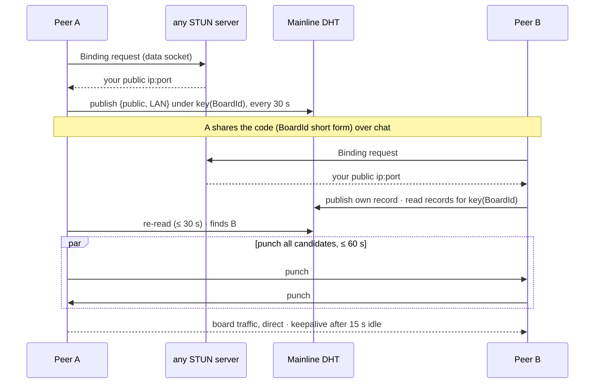

# Design: connecting peers over the internet

How two peers behind NATs find and reach each other, and where that fails.
Decision → ADR 0025 · seam rules → `docs/contracts/discovery.md` · join after connecting → `join-flow.md`.

Candidates come from manual `ip:port`, the LAN address and the DHT (later: a TURN relay). All are
tried at once; the first that answers is kept, direct before relay. STUN and the DHT never carry
board data; only a TURN relay would (post-MVP, G30).

## What works and what fails

| Situation | Result | Fix |
|---|---|---|
| normal home NATs | ✅ punch works | — |
| same LAN | ✅ via the LAN candidate | — |
| Wi-Fi switch, router reboot | ✅ heals in ~30–60 s (re-publish + re-read) | — |
| idle connection | ✅ kept open by keepalives | — |
| network blocks the DHT (campus, company) | ❌ nobody found | manual `ip:port` |
| symmetric NAT, many mobile/CGNAT pairs | ❌ punch fails | TURN relay (G30) |
| network blocks all UDP | ❌ nothing connects | TURN over TCP/443 (G30) |

## Reading guide

| Rule | Source |
|---|---|
| candidates, STUN, DHT, timers, failure message | ADR 0025 |
| one socket, split by magic | ADR 0025, ADR 0021 |
| what `wb join` accepts | ADR 0025, ADR 0016 |
| relay fallback | open (G30) |
