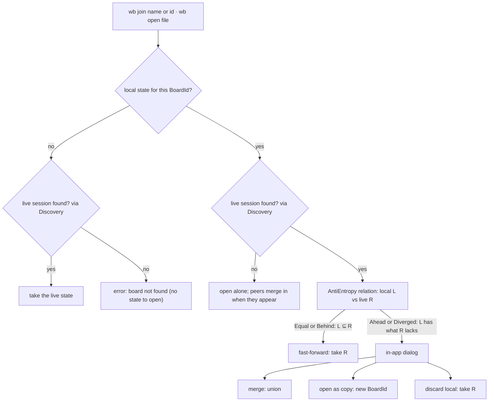

# Design: joining or reopening a board

What happens on `wb join` / `wb open` when local and live state may differ.
Overview → `docs/architecture.md` · decisions → ADR 0006, ADR 0016 in `docs/adr/`.

## Reading guide

| Rule | Source |
|---|---|
| one board per instance; boards have name + id | ADR 0016 |
| CLI `wb new / join / open / list`; Ctrl+S saves | ADR 0016 |
| fast-forward vs diverged; three choices | ADR 0006 |
| choice shown as an in-app dialog | ADR 0016 |
| fresh random `PeerId` every run, so reopened files never reuse ids | ADR 0006 |
| `relation()` semantics | `docs/contracts/anti-entropy.md` guarantee 2 |
| `list` only sees this machine until real discovery | `docs/contracts/discovery.md`, open (G12) |
| what a save file contains | open (G07) |
