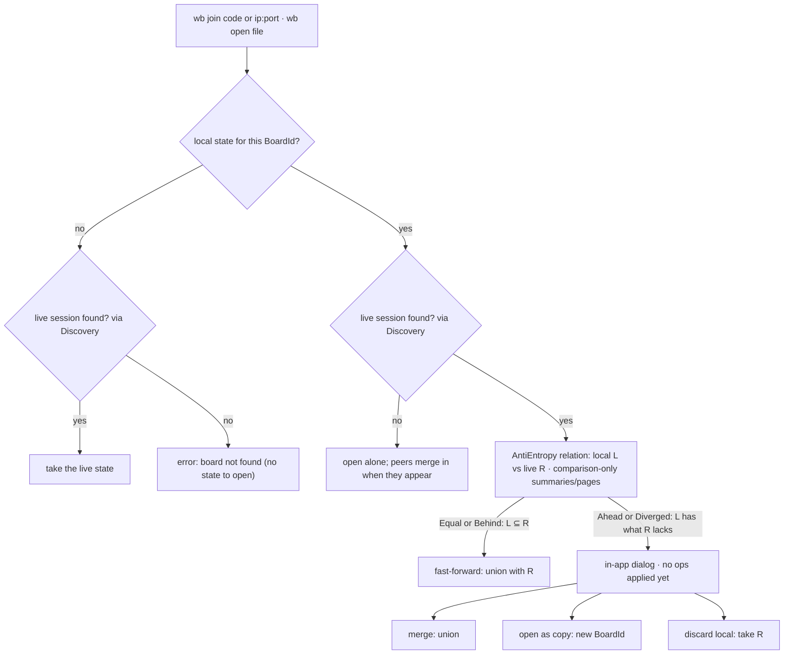

# Design: joining or reopening a board

What happens on `wb join` / `wb open` when local and live state may differ.
Overview → `docs/architecture.md` · decisions → ADR 0006, ADR 0016 in `docs/adr/`.

In the MVP, joining uses a board code (DHT, ADR 0025) or `ip:port` (T35 #72, T21 #45);
`wb list` / name lookup needs LAN discovery (M4).

While the relation is being classified, peers exchange only summaries, range hashes, or id pages;
they do not push or apply operations. For `Ahead` or `Diverged`, operation transfer starts only
after the user chooses merge or discard. Live ops arriving during the join are buffered and applied
afterwards; open-as-copy drops them (contract guarantee 7). Only *discard local* removes local ops.
A version-vector summary that falls back to range pages follows the same comparison-only rule.

## Reading guide

| Rule | Source |
|---|---|
| one board per instance; boards have name + id | ADR 0016 |
| CLI `wb new / join / open / list`; Ctrl+S saves | ADR 0016 |
| fast-forward vs diverged; three choices | ADR 0006 |
| choice shown as an in-app dialog | ADR 0016 |
| fresh random `PeerId` every run, so reopened files never reuse ids | ADR 0006 |
| `relation()` semantics | `docs/contracts/anti-entropy.md` guarantee 2 |
| `list` only sees this machine until real discovery | `docs/contracts/discovery.md`, open (G12) |
| what a save file contains | open (G07) |
