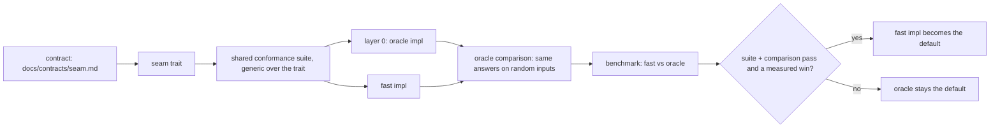

# Design: layering and testing

The layering rule as a pipeline: when a fast impl may replace the layer-0 oracle.
Rule text → `docs/architecture.md` · contracts → `docs/contracts/README.md` · team rules → `docs/team.md`.
Source for oracle and fast mappings: each contract's Impls table.

## Reading guide

| Seam | Oracle | Fast | Suite task |
|---|---|---|---|
| `SpatialIndex` | `LinearIndex` | `QuadTree` (M4) | T10 |
| `StrokeCodec` | `Raw` | `Packed` (M4) | T12 |
| `StrokeCache` | `DecodeAll` | `ChunkWorkingSet` (M4) | T25 |
| `StrokeRenderer` | `Naive` | `ChunkMesh` → `ChunkTexture` (M4) | T13 |
| `Broadcast` | `SendToAll` | `Gossip` | T18 |
| `Discovery` | candidates from manual `ip:port` (+ `Localhost` for tests) | STUN punching, DHT candidates from the driver (M1); LAN / virtual network (M4) | T17 |
| `AntiEntropy` | `FullSet` | `VersionVector` | M2 |

| Rule | Source |
|---|---|
| contract states the weakest guarantee both impls keep | `docs/contracts/README.md` |
| oracle stays forever | `docs/architecture.md` |
| benchmark method | open (G20) |
