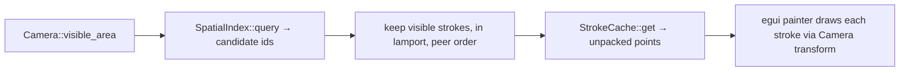
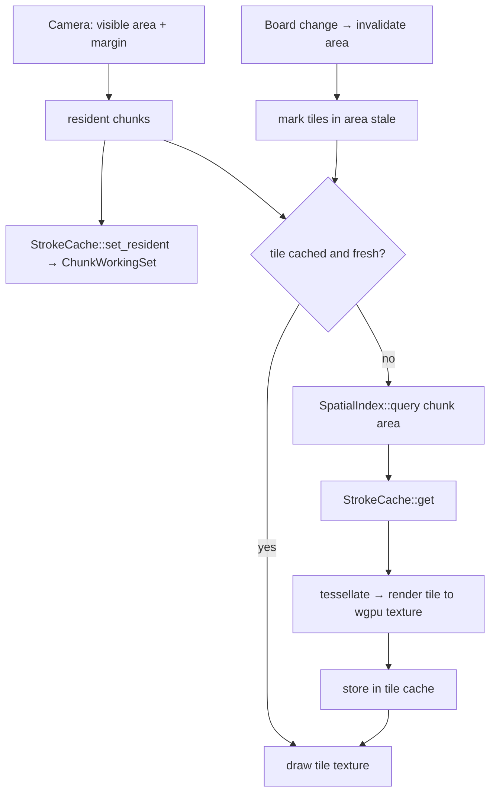

# Design: rendering

How a frame is drawn: the M0 naive path (the oracle) and the M3 chunk path.
Overview → `docs/architecture.md` · contracts → `docs/contracts/stroke-renderer.md`, `docs/contracts/stroke-cache.md`.

## M0 — `Naive` renderer, every frame

## M3 — chunk path

## Reading guide

| Rule | Source |
|---|---|
| frame = visible strokes in viewport, `visible()` order | `docs/contracts/stroke-renderer.md` guarantee 1 |
| fast path matches `Naive` within pixel tolerance | `docs/contracts/stroke-renderer.md` guarantee 3 |
| points come only through `StrokeCache` | ADR 0018 |
| widths in world units, so tiles stay valid per zoom level | ADR 0013 |
| zoom range 0.5×–2× keeps the level pyramid small | ADR 0013 |
| tile size, levels, margin, byte budgets | open (G16) |
| egui + wgpu | ADR 0007, `docs/research/gui-stack.md` |
