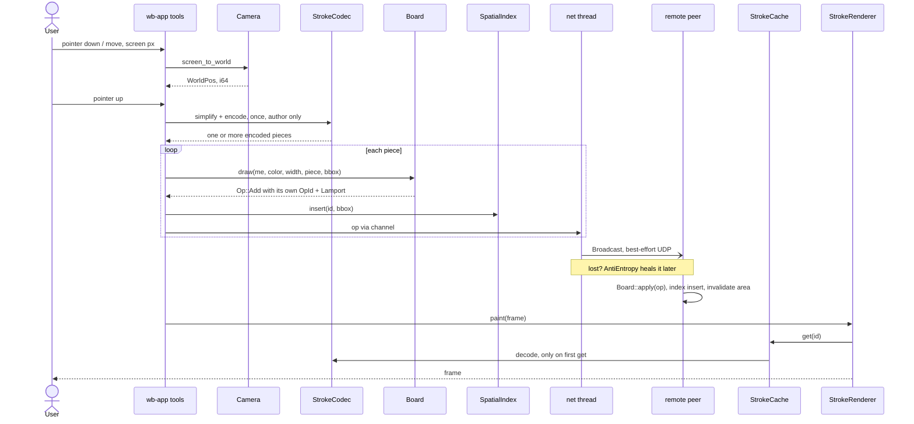

# Design: stroke lifecycle

One stroke from pointer to pixels on every peer, as a sequence diagram.
Overview → `docs/architecture.md` · convergence details → `sync-and-convergence.md` (this folder).

## Reading guide

| Step | Rule | Source |
|---|---|---|
| screen → world | all coordinates `i64`, 1 unit = 1/16 px | ADR 0014, `docs/contracts/camera.md` |
| simplify + encode | lossy, once, at the author; every peer stores identical bytes | ADR 0005, `docs/contracts/stroke-codec.md` |
| `Board::draw` | assigns `OpId` and Lamport; strokes stay encoded | ADR 0008, 0009, `docs/contracts/board.md` |
| Broadcast | best-effort; no delivery promise | ADR 0003, `docs/contracts/broadcast.md` |
| remote apply | idempotent, any order | ADR 0001, `docs/contracts/board.md` |
| `StrokeCache::get` | unpacked points only through the cache | ADR 0018, `docs/contracts/stroke-cache.md` |
| strokes appear on pen-up only | no live ink in v1 | ADR 0012 |
| oversized strokes split into independently ordered pieces | ADR 0020 | `docs/contracts/stroke-codec.md` |
