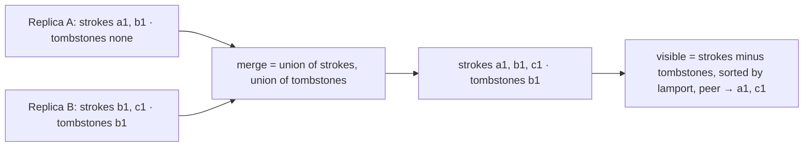
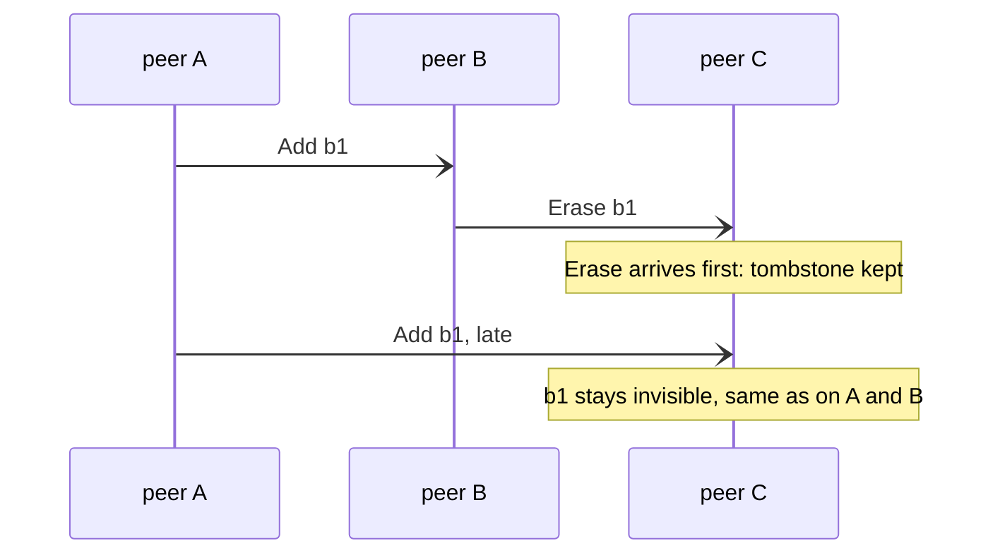
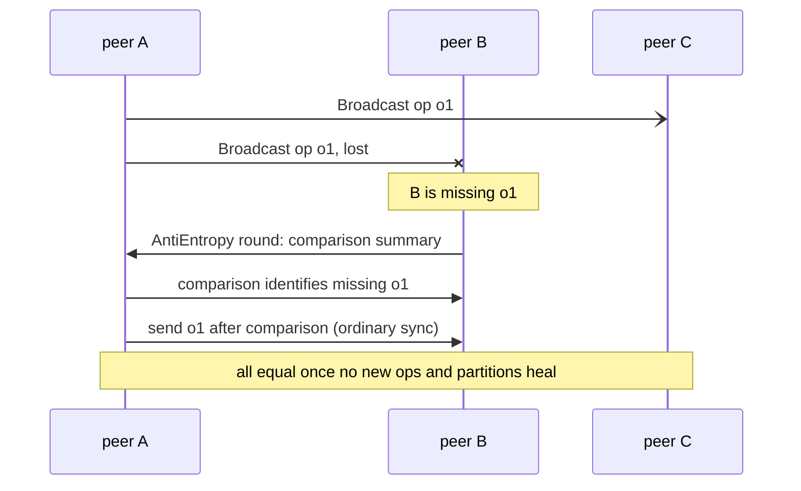

# Design: sync and convergence

Why every peer ends with the same picture: the `Board` set, erase-wins, and anti-entropy healing loss.
Overview → `docs/architecture.md` · contracts → `docs/contracts/board.md`, `docs/contracts/anti-entropy.md`.

## The board is a set — merge is union

## Erase wins, whatever the arrival order

## Broadcast may lose; anti-entropy heals

## Reading guide

| Rule | Source |
|---|---|
| state = strokes + tombstones; merge = union | ADR 0001, `docs/contracts/board.md` guarantee 1 |
| erase wins | ADR 0001, `docs/contracts/board.md` guarantee 3 |
| draw order `(lamport, peer)` | ADR 0008, `docs/contracts/board.md` guarantee 4 |
| every op has an `OpId` (dedup key) | ADR 0009 |
| broadcast is best-effort | `docs/contracts/broadcast.md` |
| convergence comes from anti-entropy | ADR 0003, `docs/contracts/anti-entropy.md` guarantee 1 |
| round pacing, peer choice, page size | ADR 0023 |
| version-vector growth per run | ADR 0022 |
