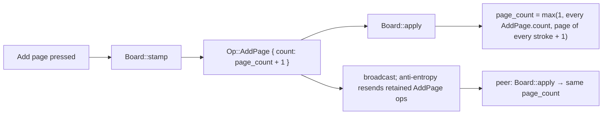
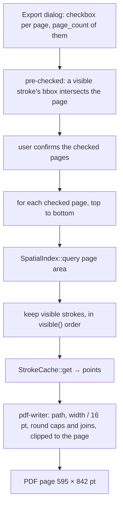

# Feature: pages and PDF export

A board is a vertical stack of A4 pages that every peer shares; you draw only on pages, add pages
at the end, and export the pages you pick to a vector PDF. Decision → ADR 0027 · board laws →
`docs/contracts/board.md` · tasks → T30 #66 (pages in `wb-core`), T32 #69 (PDF export).

## What the user sees

- The board opens with page 0. "Add page" appends one page below the last; if two peers press it
  at once, they get one new page, not two, and whatever both draw on it overlaps.
- The pen draws only inside a page's printable area. Leaving the page ends the stroke; coming back
  starts a new one, so no line crosses the gap between pages.
- "Export PDF" opens a dialog with a checkbox per page; pages with something drawn start checked.
  The PDF holds the checked pages, top to bottom, as sharp vector strokes.

## Pages on the board

## Export

## Reading guide

| Rule | Source |
|---|---|
| pages are shared board state: `AddPage` + `page_count` as a maximum | ADR 0027 · `board.md` guarantees 7–8 |
| page `n` geometry: A4 portrait, 1 pt = 16 world units, 16 pt gap, 14 pt printable inset | ADR 0027 · ADR 0014 |
| strokes end at the page edge; renderer and PDF clip to the page | ADR 0027 |
| vector PDF via `pdf-writer`; checkboxes, non-empty pages pre-checked | ADR 0027 |
| board mode `Stacked` / `Infinite` fixed at creation; MVP only `Stacked` | ADR 0027 · file header open (G07) |
| colours in the PDF | `Stroke` colour; opacity open (opaque-colours ADR proposed in #105) |
